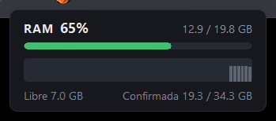

# ram-lite

Widget mínimo para Windows con el uso de memoria RAM. Una ventana Win32 dibujada con GDI, sin
WebView, sin hilos y sin red. El `.exe` pesa unos 160 KB y usa menos de 2 MB de memoria privada.



- **RAM** en uso: porcentaje, GB usados de los totales y una barra. Es verde, pasa a ámbar desde
  el **75 %** y a rojo desde el **90 %**.
- Gráfica de los **últimos 2 minutos** (una muestra cada 2 s). Las columnas van en gris si la RAM
  estaba en nivel normal y en ámbar o rojo si estaba alta.
- Pie con la RAM **libre** y la memoria **confirmada** (commit) frente a su límite
  (RAM + archivo de paginación), igual que en el Administrador de tareas.
- Icono en la bandeja que es un medidor: se llena según la RAM en uso, con el mismo color, y al
  pasar el ratón muestra `RAM 65% - 12.9 / 19.8 GB`. Clic izquierdo muestra u oculta la ventana;
  clic derecho abre el menú: mostrar/ocultar, **Administrador de tareas**, **Siempre encima**,
  **Iniciar con Windows** y salir.
- La ventana se arrastra desde cualquier punto y la X (aparece al pasar el ratón) la oculta a la
  bandeja. Una sola instancia, recuerda la posición (vuelve arriba a la derecha si el monitor ya
  no está), DPI por monitor, español o inglés según el idioma de Windows.

Los colores y las medidas son los de la versión lite de
[claude-usage-widgets](https://github.com/abelardodiaz/claude-usage-widgets), de donde salen
también la ventana, la colocación y "Iniciar con Windows".

## Compilar

Requiere Rust estable (1.90 o más reciente) en Windows.

```powershell
cargo build --release
# el exe queda en target\release\ram-lite.exe
cargo fmt --all --check
cargo clippy --all-targets --locked -- -D warnings
cargo test --locked
```

### Instalar desde el código

```powershell
powershell -ExecutionPolicy Bypass -File instalar.ps1
```

Compila en release, cierra el ram-lite que esté corriendo, copia el exe a
`%LOCALAPPDATA%\ram-lite\ram-lite.exe` y lo arranca desde ahí. "Iniciar con Windows" apunta a
esa ruta fija.

## Datos y preferencias

- No escribe archivos. Las preferencias (siempre encima y posición) van en el registro, en
  `HKCU\Software\ram-lite`.
- "Iniciar con Windows" es el valor `ram-lite` en
  `HKCU\Software\Microsoft\Windows\CurrentVersion\Run`; el menú lo lee de ahí cada vez.
- Para desinstalar: desmarcar "Iniciar con Windows", salir, borrar el exe y, si quieres, la
  clave `HKCU\Software\ram-lite`.

## Cómo mide

`GlobalMemoryStatusEx` cada 2 s, en el mismo hilo de la ventana (la llamada no bloquea):

| En pantalla | Campo |
|---|---|
| Usada / total | `ullTotalPhys - ullAvailPhys` / `ullTotalPhys` |
| Libre | `ullAvailPhys` (disponible, incluye la caché que Windows puede soltar) |
| Confirmada | `ullTotalPageFile - ullAvailPageFile` / `ullTotalPageFile` |

Los GB son de 1024³ bytes, como el Administrador de tareas.

## Licencia

MIT.
